# CloudLinux Advantage

## Overview

CloudLinux Advantage for WHMCS automatically configures "Configurable options" that can be linked to the Product/Service.

When a client orders/upgrade a configurable option, a request will be sent to the server to change the CloudLinux features status.

## Installation and Configuration

### Installation and Update

1. The addon sends requests to servers from a WHMCS cron task that is set to run every minute. Run the WHMCS system cron every minute; if it runs less often, requests wait for the next run. [How to set up the cron](https://docs.whmcs.com/Crons#Setting_up_the_Cron_Tasks).
2. On Plesk servers, the required [extension](./#plesk-extension) is installed and activated automatically with AccelerateWP 1.9-8 or later. AccelerateWP features in the addon require AccelerateWP 1.9-16 or later on the server.
3. Download archive [https://repo.cloudlinux.com/plugins/whmcs-cl-advantage-plugin-latest.zip](https://repo.cloudlinux.com/plugins/whmcs-cl-advantage-plugin-latest.zip)

<div class="notranslate">

```
wget -q https://repo.cloudlinux.com/plugins/whmcs-cl-advantage-plugin-latest.zip
```

</div>

4. Unzip the archive to <span class="notranslate">`<whmcs_root>/modules/addons`</span> folder

<div class="notranslate">

```
unzip whmcs-cl-advantage-plugin-latest.zip -d <whmcs_root>/modules/addons
```

</div>

5. If your hosting requires specific files permissions, change them accordingly in the folder: <span class="notranslate">`<whmcs_root>/modules/addons/cloudlinux_advantage`</span>
6. Go to the admin panel page "WHMCS/System Settings/Addon Modules", activate "CloudLinuxAdvantage"
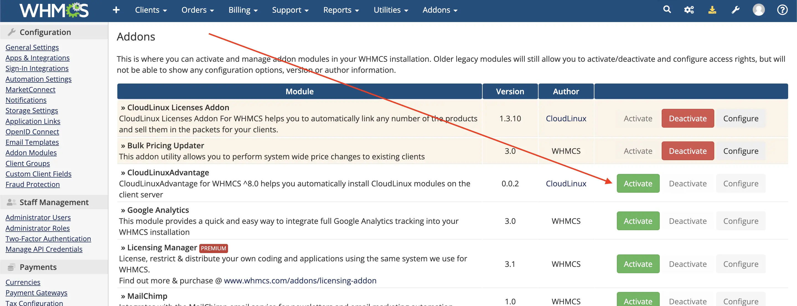
7. Configure addon:
   1. Debug mode is enabled when the addon is activated. Disable it if you do not need it. Logs are stored in the "Module Log".
   2. Allow administrator access to the addon page to view information about the status of the servers
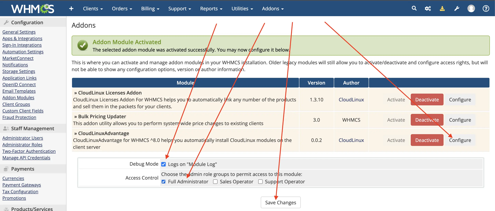

:::tip Notes
When upgrading to a new version, be sure to open the "WHMCS/System Settings/Addon Modules" page to apply the module changes.
:::

### Setting prices for "Configurable options"

During addon activation, the AccelerateWP configurable option groups "AccelerateWP Premium Addon", "AccelerateWP CDN Addon", and "AccelerateWP for Package Bundles" are created automatically (System settings/Configurable Options). The "AccelerateWP for Package Bundles" group is for system use. After an upgrade from an older version, the previous group is named "AccelerateWP Addons".

:::tip Notes
Don't change the name of the group, options and sub-options!
:::

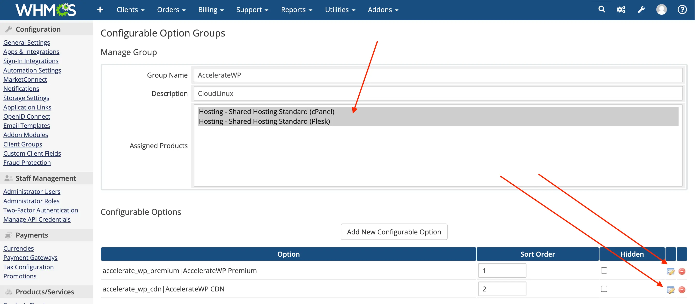

In the settings of the "AccelerateWP Premium Addon" and "AccelerateWP CDN Addon" groups, you need to configure:
* Choose for which products (cPanel/Plesk/DirectAdmin) you can additionally order the service.
  * AccelerateWP options work on cPanel, Plesk, and DirectAdmin.
* For the "accelerate_wp_premium|AccelerateWP Premium" option, set the cost.
  * In the option price settings, there are two options, On and Off. Adjust prices as you see fit.
* For the "accelerate_wp_cdn|AccelerateWP CDN" option, set the cost.
   * In the option price settings, there are options: Off, 50 GB, 100 GB etc. Adjust prices as you see fit. You can hide unwanted tariffs using the "Hide" checkbox.

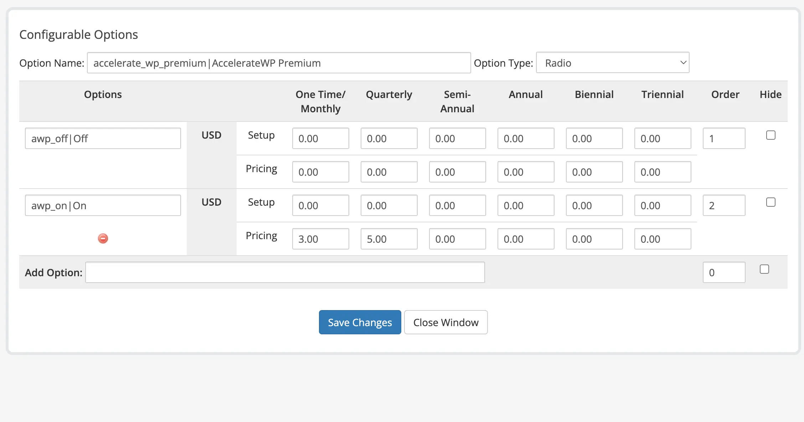


### Product/Service setup

Set up your service to work with "Configurable options" in the "System settings/Products/Services".

1. Choose the payment type, One time or Recurrent.
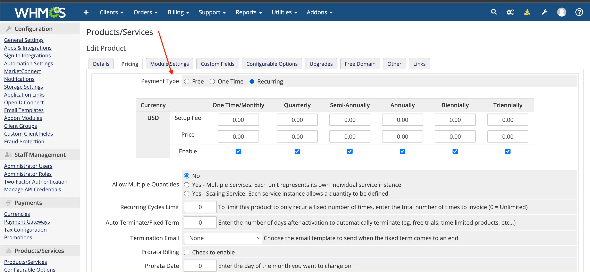
2. Make sure the product is associated with the required configurable option group, for example "AccelerateWP Premium Addon".
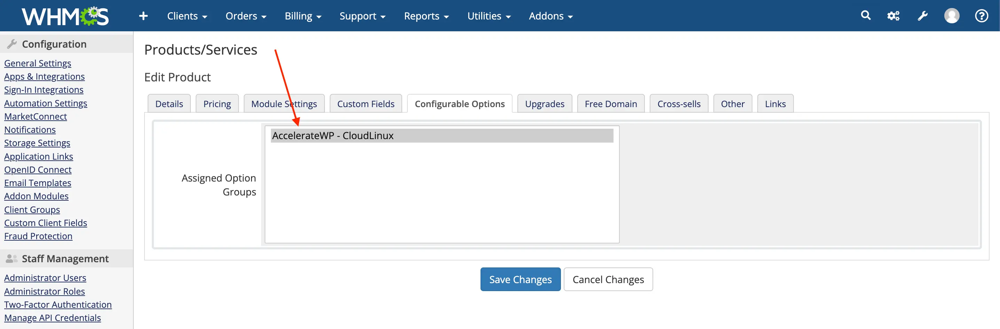
3. Allow clients to upgrade Configurable options so they can purchase AccelerateWP for existing subscriptions.
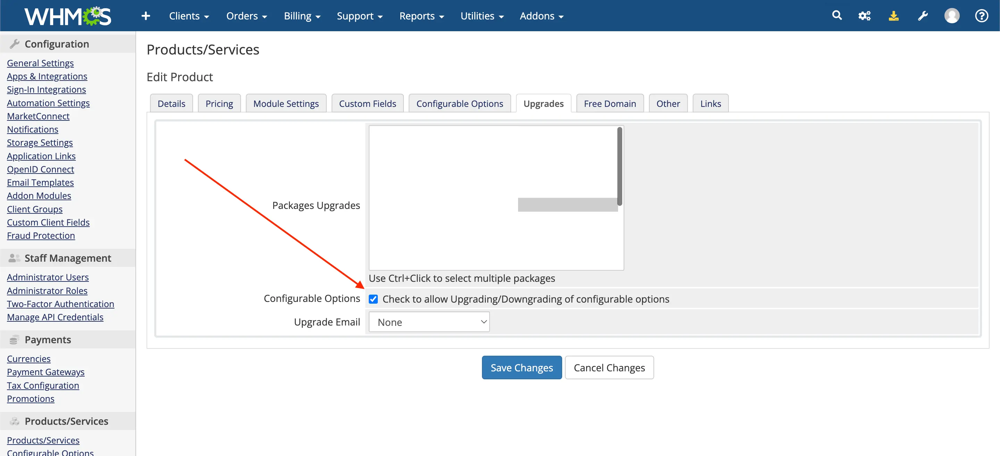
4. Save changes.
5. Existing customers can upgrade their AccelerateWP Premium settings by changing the order using the "Upgrade/Downgrade options" button.

6. New customers will be able to select AccelerateWP settings during order creation

7. The administrator can manually change the setting of AccelerateWP by editing the purchased service by the customer
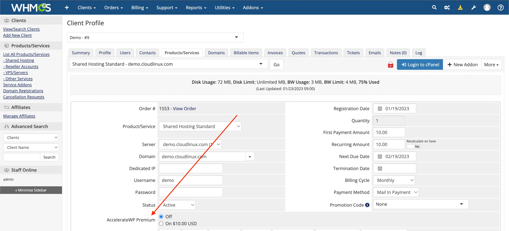

### CloudLinuxAdvantage addon page

In the **AccelerateWP Premium** tab, choose **Add-on subscription** to offer AccelerateWP Premium as a paid option, or **Value-add for hosting packages** to include it in selected hosting packages.

In case the configurable options were accidentally removed, you can re-install them on the CloudLinuxAdvantage settings page.

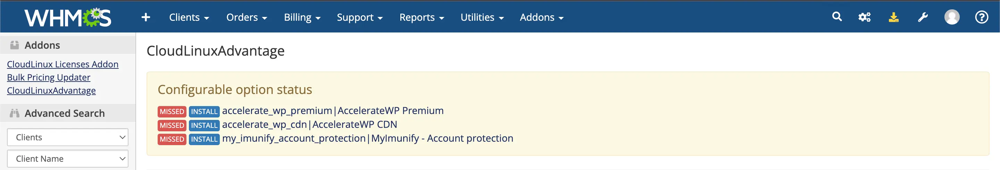

The table of each section lists the activated hosting packages with their user counts and status. The status info shows activation or deactivation in progress and the number of incompatible servers. Use **Deactivate** to remove a package.

:::tip Note
Deactivating the addon will delete the table with the history of AccelerateWP activity on the servers.
:::

The addon does not list individual requests. Errors are written to the Module Log when debug mode is on.

To offer AccelerateWP Premium, open its section and select the hosting packages under **Add packages**. Value-add for hosting packages adds one package at a time; repeat **Add packages** for more. For an add-on subscription, set the monthly price if the form asks for it; the other billing cycles are calculated from the monthly price. Click **Next**. In the **Automatic Server Activation** dialog, review the changes and click **Scan and Activate**. Cron activates the feature on all compatible servers that host the selected packages. AccelerateWP CDN has no section on this page; link its option group to the product as described in [Product/Service setup](./#product-service-setup).

The **MyImunify** tab offers MyImunify - Account protection as an add-on subscription on cPanel servers. Select the hosting packages under **Add packages**, click **Next** and then **Scan and Activate**. More details: [MyImunify for hosting administrators](https://docs.imunify360.com/myimunify/#what-is-myimunify-for-hosting-admin).

To deactivate a package, click **Deactivate** next to it under **Currently active**, then click **Confirm**.

### FAQ

#### How WHMCS communicates with end-server

The addon tracks the change in the order and services of the client.  
For those client services that have the configurable options "AccelerateWP", a request is sent to the server to change the status of AccelerateWP products.

Requests are processed by the WHMCS cron task. If a request fails, the task retries it after 5 seconds.

The addon page shows the status of each activated hosting package, including the number of incompatible servers.

If an error occurs, check the Module Log when debug mode is enabled.

The CloudLinuxAdvantage enters the "Allowed" status when the client service's status is set to "Active" and the configurable options "On" is selected. In other cases, the status will be set to "Default" and the feature will be turned off for user.

#### How to automatically open the "Upgrade/Downgrade Options" page?

Parameters can be used to determine the billing account of the user in order to display the proper page. When the addon configures a server, it sets the AccelerateWP Premium upgrade URL from the WHMCS Domain setting. Make sure that this setting points to the root of your WHMCS instance.

#### Update AccelerateWP 0.0.1 module to CloudLinuxAdvantage 0.0.2

If you previously had version 0.0.1 of the module installed, you need to perform the following procedure:
* Follow the process for installing the module version 0.0.2
* The module will automatically update the database
* After that, you can deactivate and remove the old module AccelerateWP 0.0.1 (`<whmcs_root>/modules/addons/acceleratewp`)
* If you are using the [extension](./#plesk-extension), you need to update it to the latest version from the "accelerate-wp-1.5-1" package

```
https://your.whmcs.com/?m=cloudlinux_advantage&action=provisioning&username=democom&domain=demo.com&server_ip=10.51.0.10
```

| Parameter | Value                 | Description                                                                                                             |
|-----------|-----------------------|-------------------------------------------------------------------------------------------------------------------------|
| m         | cloudlinux_advantage  | Constant.                                                                                                               |
| action    | provisioning          | Constant.                                                                                                               |
| username  | democom               | Customer's account name.                                                                                                |
| domain    | demo.com              | Optional. Customer's account primary domain. Not used to find the service.                                              |
| server_ip | 10.51.0.10            | Primary IP of the server where AccelerateWP is installed.                                                               |
| suite     | accelerate_wp_premium | Optional. To display the settings of the specified suite only. Options: accelerate_wp_premium or accelerate_wp_cdn_pro. |

## Plesk extension

:::tip Note
From version AccelerateWP 1.9-8, installation and activation of the extension for Plesk starts automatically.
:::

The extension adds the ability to execute <span class="notranslate">`cloudlinux-awp-admin`</span> commands, such as <span class="notranslate">`set-suite`</span>, through the Plesk XML API.

On AccelerateWP versions older than 1.9-8, install it manually only if you use the AccelerateWP WHMCS billing integration.

:::tip Note
Requires Plesk version 17.0 or higher  
The Plesk extension is available since accelerate-wp-1.3-2 version
:::

### Installation

1. Install

<div class="notranslate">

```
/usr/sbin/plesk bin extension -i /usr/share/cloudlinux/plesk-accelerate-wp-latest.zip
```

</div>

2. Activate

<div class="notranslate">

```
/usr/sbin/plesk bin extension --enable accelerate-wp
```

</div>

### Deinstallation

<div class="notranslate">

```
/usr/sbin/plesk bin extension -u accelerate-wp
```

</div>

## End user workflow

### How to update an existing order (service)

1. Open the services page through the menu "Services - My services"
2. Choose the service you need
   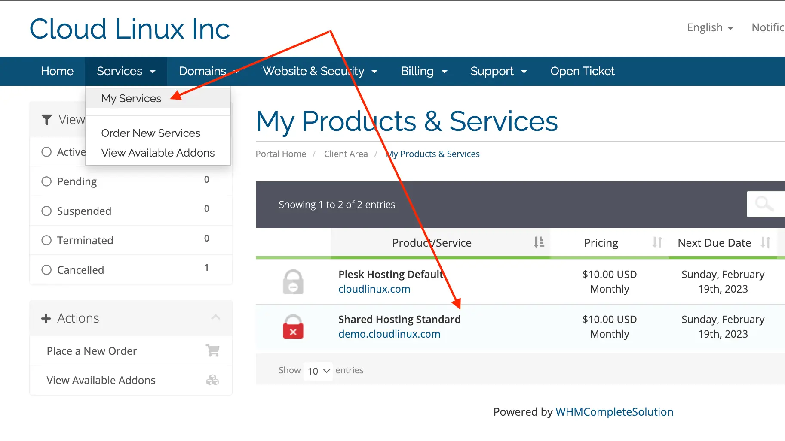
3. Select the action "Upgrade/Downgrade Options"
   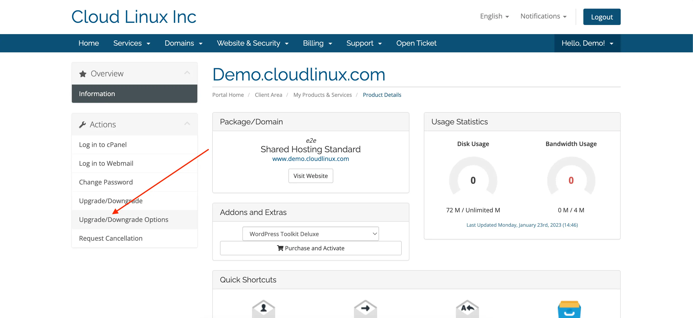
4. Choose a new configuration and place an order
   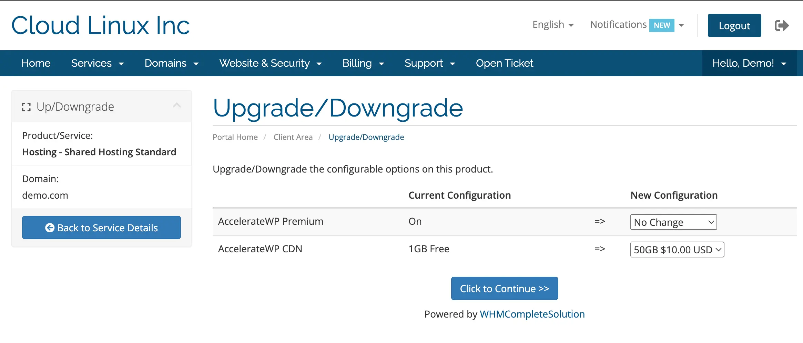
5. Changes will occur automatically after 1 minute or after confirmation of the order by the service provider

### How to checkout new order

1. Select a service in the service provider's WHMCS portal
2. A service with AccelerateWP enabled will display options to enable them
   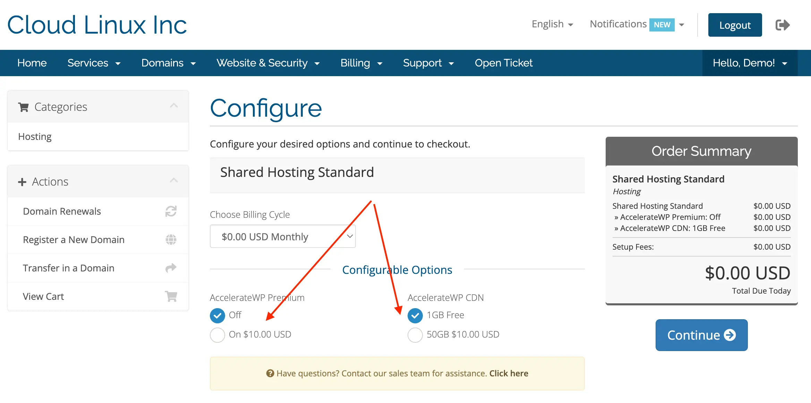
3. Changes will occur automatically after 1 minute or after confirmation of the order by the service provider
4. After purchase, you need to manually activate the modules in the AccelerateWP panel

## Changelog

* 0.0.3
  * Added the ability to purchase [MyImunify - Account protection](https://docs.imunify360.com/myimunify/#what-is-myimunify-for-hosting-admin)
  * Add the ability to bulk send the statuses of custom options "MyImunify - Account protection" to the servers

* 0.0.2
  * Module renamed from Accelerate WP to CloudLinux Advantage
  * Added the ability to purchase AccelerateWP CDN
  * Improved display of service and server names on the AccelerateWP module page
  * Added the ability to hide suites on the update options page
  * Changed "m" parameter in provisioning link (upgrade url) from accelerate_wp to cloudlinux_advantage

* 0.0.1
  * Beta release

## Requirements

* 0.0.3
  * Imunify360 ^7.4.0

* 0.0.2
  * WHMCS ^8.0
  * accelerate-wp-1.5-1

* 0.0.1
  * WHMCS ^8.0
  * accelerate-wp-1.3-2